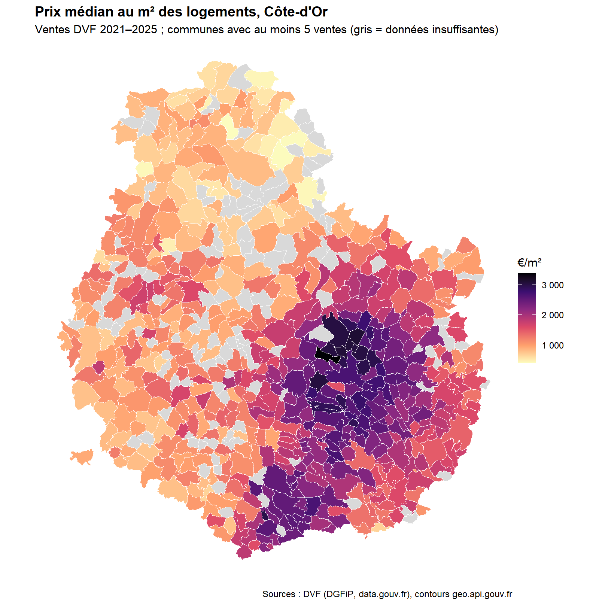
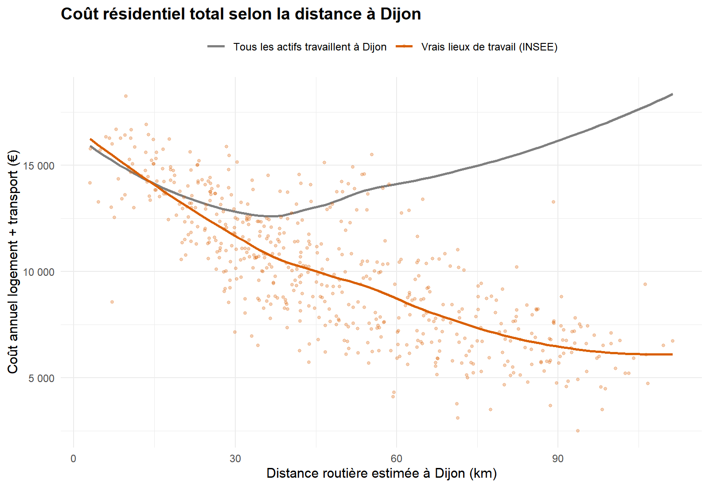
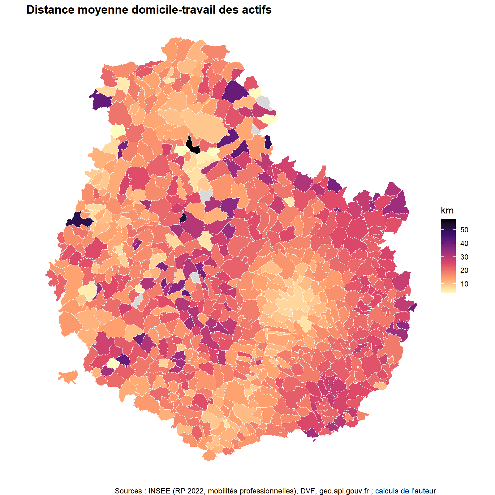
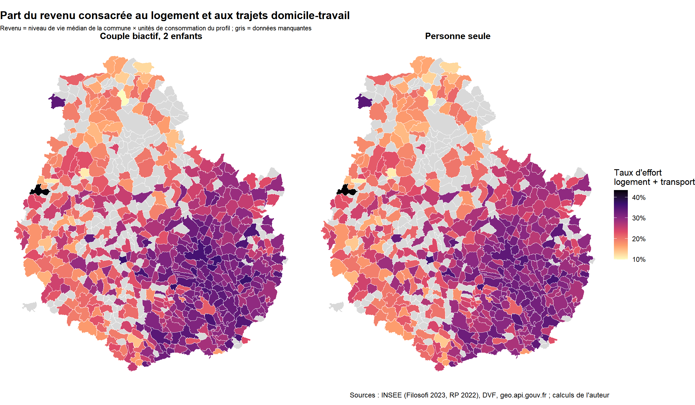

# Coût résidentiel (logement + transport) des communes de Côte-d'Or

Ce projet construit un **indicateur territorialisé du coût résidentiel** pour les 698 communes de Côte-d'Or. L'indicateur additionne le coût annuel du logement et celui des trajets domicile-travail, puis le rapporte au revenu des ménages. Le calcul est fait pour plusieurs profils de ménages.

Il est inspiré de l'indice américain *Housing + Transportation Affordability Index* (Center for Neighborhood Technology). Tout est réalisé sous R, à partir de données publiques françaises.

*Auteur : Hamed Dilan Bomisso, M2 Économie du développement, CERDI, Université Clermont Auvergne.*

---

## Principaux résultats

**1. Le prix du logement baisse fortement avec la distance à Dijon.** Le coût annuel d'un logement de 70 m² acheté à crédit passe d'environ 13 500 € à moins de 10 km de Dijon à environ 4 300 € au-delà de 80 km.

**2. Le coût total dépend fortement de l'hypothèse sur le lieu de travail.** Si l'on suppose que tous les actifs travaillent à Dijon, le coût total dessine un U, avec un minimum vers 30-40 km. Avec les **vrais lieux de travail** (INSEE, mobilités professionnelles 2022), le U disparaît : loin de Dijon, la plupart des actifs travaillent sur place ou dans un pôle local. Seuls 2 % des actifs résidant à plus de 80 km travaillent à Dijon, contre 66 % à moins de 10 km.

**3. Le coût de transport pèse le plus dans la couronne périurbaine.** La distance moyenne domicile-travail culmine à environ 22 km pour les communes situées à 30-40 km de Dijon. Elle redescend ensuite à environ 14 km dans le rural plus éloigné.

**4. Le taux d'effort logement + transport.** Il atteint environ 30 % du revenu près de Dijon et sur la côte viticole, contre 18-19 % au-delà de 80 km.

---

## Méthode

| Composante | Calcul | Source |
|---|---|---|
| Coût du logement | Prix médian au m² × surface, converti en annuité de prêt (20 ans, 3,5 %) | DVF géolocalisées 2021-2025 (DGFiP) |
| Coût du transport | Distance moyenne domicile-travail pondérée par les flux d'actifs × 2 × 220 jours × 0,30 €/km | INSEE, RP 2022, mobilités professionnelles |
| Distances | Distance à vol d'oiseau entre communes × 1,3 (approximation de la distance routière) | geo.api.gouv.fr |
| Revenu | Niveau de vie médian de la commune × unités de consommation du profil | INSEE, Filosofi 2023 |

**Choix de nettoyage des données DVF :** ventes uniquement, mutations portant sur un seul logement (maison ou appartement), surface d'au moins 10 m², prix entre 200 et 10 000 €/m². Le prix médian n'est calculé que pour les communes ayant au moins 5 ventes.

**Profils de ménages :** une personne seule (40 m², un navetteur) et un couple biactif avec deux enfants (90 m², deux navetteurs).

Toutes les hypothèses sont regroupées en tête de chaque script, dans la liste `hyp`, pour faciliter les analyses de sensibilité.

---

## Limites et prochaines étapes

- **Effet de composition :** les ventes à Dijon portent surtout sur des appartements, et celles en zone rurale surtout sur des maisons. Une approche hédonique ou des prix séparés par type de bien seraient plus rigoureux.
- **Locataires :** le calcul suppose un achat. L'intégration de la carte des loyers permettra de traiter les ménages locataires.
- **Temps de trajet :** il n'est pas encore valorisé. L'ajouter rapprocherait l'optimum de Dijon.
- **Mode de transport :** seule la voiture est prise en compte, avec un coût au kilomètre forfaitaire.
- **Secret statistique :** le revenu n'est pas publié pour les petites communes. Elles pourraient être complétées par le revenu de leur intercommunalité.
- **Sélection résidentielle :** le revenu médian est celui des habitants actuels. Les ménages aisés se concentrent près de Dijon, ce qui réduit leur taux d'effort apparent.

---

## Reproduire les résultats

1. Cloner le dépôt et ouvrir `Cout-Residentiel-Cote-dor.Rproj` dans RStudio.
2. Lancer les scripts dans l'ordre. Les données brutes sont téléchargées automatiquement dans `data/raw/`, qui n'est pas versionné.

| Script | Rôle |
|---|---|
| `01_prix_dvf.R` | Prix médian au m² par commune |
| `02_cout_residentiel.R` | Coût logement + transport, hypothèse « tous travaillent à Dijon » |
| `03_flux_insee.R` | Coût avec les vrais lieux de travail (flux INSEE) |
| `04_taux_effort.R` | Taux d'effort par profil de ménage |

Packages R utilisés : `dplyr`, `readr`, `tidyr`, `ggplot2`, `sf`.

---

## Sources

- DGFiP, *Demandes de valeurs foncières géolocalisées* (data.gouv.fr)
- INSEE, *Mobilités professionnelles en 2022 : déplacements domicile-lieu de travail*
- INSEE, *Indicateurs sur les revenus et la pauvreté au niveau local en 2023* (Filosofi)
- Contours et centres des communes : API Découpage administratif (geo.api.gouv.fr)
- Center for Neighborhood Technology, *H+T Affordability Index*
